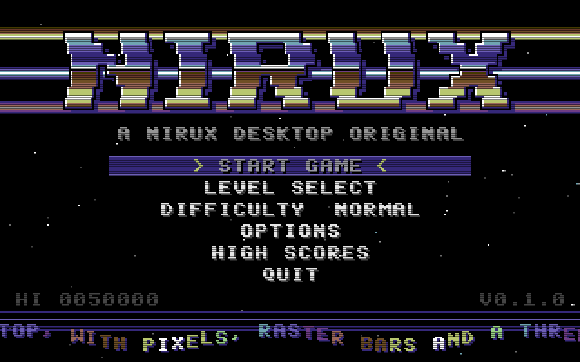

# NIRUX

An original Commodore 64 style shooter for the NIRUX desktop: three kinds
of play in one campaign, chunky pixels in the sixteen C64 colours, raster
bars, and a soundtrack played live by a SID-style synthesiser written for
the game.

**Status: playable demo (0.1.0)** · Part of the [NIRUX](https://github.com/nirucon/nirux) suite · [MIT License](LICENSE)



More screenshots: [sector 1, the capital ship](docs/screenshots/sector1.png),
[the Warden](docs/screenshots/boss.png),
[sector 2, isometric flight](docs/screenshots/sector2.png),
[sector 3, on foot](docs/screenshots/sector3.png).

## About

NIRUX is a game to play during a break. It takes its feel from the shooters
of the 1980s home computers, but everything in it is new: the ships, the
enemies, the levels, the pixel art, the font and the music were all made
for NIRUX, in code and text in this repository. No assets are borrowed.

The finished campaign will have eight sectors of four to six minutes each,
about forty minutes straight through, easy at the start and harder later.
This demo has the first three, one of each kind of play:

1. **The Outer Rim** (space shooter): fly right through fighter waves and
   an asteroid field, over a capital ship a kilometre long that you take
   apart turret by turret and generator by generator, to the Warden at the
   end. Easy and welcoming.
2. **Glass Dunes** (isometric flight): fly up the diagonal over a fortress
   deck above dunes of glass. Up and down change altitude and the shadow on
   the deck shows where you are. Climb over walls, fly over or under energy
   fences, weave between towers, and break the Monolith and its shards.
3. **Iron Jungle** (on foot): fight up a jungle road past riflemen,
   grenadiers and gun nests, cross the river, survive the tank at the
   outpost and bring down the Gatekeeper at the fortress gate.

Every cleared sector is saved and stays open in **Level select**, so one
sector now and then is a game of its own.

## Features

- **Three play modes** with their own enemies, patterns, power-ups (weapon
  levels, shield, bombs, extra lives) and a boss each, plus score, lives,
  extra lives every 40000 points, game over and a sector clear tally.
- **Easy, Normal and Hard**, a local high score table with name entry, and
  progress saved after every sector.
- **The C64 look**: a 320x200 picture in the sixteen C64 colours (the
  "Pepto" palette), an 8x8 font drawn for the game, parallax starfields,
  raster bars, a chrome logo, a sine scroller, explosions with debris and
  smoke, screen shake and white flashes, and optional CRT scanlines.
- **Any screen**: the picture is scaled by the largest whole number that
  fits (sharp pixels at every size, HiDPI included) and the space around it
  becomes the C64 border, in a colour that changes from sector to sector
  and flashes with the big explosions. Fullscreen on the current monitor by
  default, F11 to switch, and any window size works.
- **SID-style sound**: three music voices with triangle, sawtooth, pulse
  and noise, SID timed envelopes, pulse width modulation, sync and ring
  modulation, and a resonant multimode filter with sweeps, plus two voices
  for the sound effects. Arpeggio chords, vibrato, echo voices and drums
  that cut into the bass line, the way three voices were always made to
  sound like more.
- **Light on resources**: one small window, a fixed 60 Hz step that sleeps
  between frames, the scaling done by the X server (RENDER) so only the
  small picture leaves the game, and sound through `pw-cat`, `pacat` or
  `aplay`. In tests it used about 3 to 7 percent of one core at 1920x1080.
- **Attract mode**: leave the title screen alone and the high scores and a
  demo of a random sector play.
- **Menus in the NIRUX theme**: the menu text follows the theme NIRUWM
  uses; the game itself stays in C64 colours.

## The soundtrack

| Song | Where |
| --- | --- |
| Nirux | the title theme, A minor, a slow rise into a soaring chorus |
| Outer Rim | sector 1, D major, bright and heroic |
| Glass Dunes | sector 2, E minor, mysterious and driving |
| Iron Jungle | sector 3, C minor, a march with snare rolls |
| Warden | every boss, fast and tense |
| Signal Lost | game over |
| Sector Clear | the fanfare after a sector |

`nirux-thegame --render-wav SONG FILE` writes any of them to a WAV file
(`--list-songs` lists the names).

## Controls

| Key | Action |
| --- | --- |
| Arrows or WASD | move (altitude and side to side in sector 2) |
| Space, Ctrl, Z or J | fire (hold for auto fire) |
| X, Shift, Alt or K | bomb (sectors 1 and 2) or grenade (sector 3) |
| Enter | start, confirm |
| Esc or P | pause, back |
| F11 | fullscreen on or off |
| M | mute |

A gamepad or joystick works through the Linux joystick interface
(`/dev/input/js*`): the left stick or d-pad moves, A fires, B is the
special, Start pauses.

## Install

```sh
git clone https://github.com/nirucon/nirux-thegame
cd nirux-thegame
./install.sh
```

The installer builds the game with cargo (Rust 1.85 or newer; it offers to
install cargo when it is missing) and puts `nirux-thegame` in
`~/.local/bin`, with a desktop entry and an icon. Run `./uninstall.sh` to
remove it (`--purge` also removes settings, progress and high scores).

Needs: X11 (any window manager, or none), and for sound one of `pw-cat`
(PipeWire), `pacat` (PulseAudio) or `aplay` (ALSA).

## Command line

```text
nirux-thegame                 play (fullscreen unless the settings say otherwise)
nirux-thegame --windowed      play in a window
nirux-thegame --level N       start a game at sector N (1 to 3)
nirux-thegame --demo          start in the attract mode
nirux-thegame --selftest [FRAMES]
                              play every sector with the autopilot, without a
                              window or sound, and check the menus and music
nirux-thegame --render-wav SONG FILE [SECONDS]
nirux-thegame --list-songs
nirux-thegame --version
```

## Files

- Settings: `$XDG_CONFIG_HOME/nirux-thegame/config.toml` (fullscreen, CRT
  scanlines, music and effects volume, echo, difficulty, and an optional
  `audio` command that plays raw 16-bit stereo PCM from standard input,
  with `%r` for the sample rate).
- Progress and high scores: `$XDG_DATA_HOME/nirux-thegame/save.toml`.

## Development

```sh
cargo fmt --all -- --check
cargo clippy --release --all-targets -- -D warnings
cargo test --release
sh tests/xvfb.sh target/release/nirux-thegame 99
```

`tests/xvfb.sh` runs the game in a private Xvfb with a temporary home and
the sound going to a file, and checks the window, the picture, fullscreen,
starting a game, sound, pause, quitting and the saved settings. The code is
small and has two dependencies: `x11rb` (with MIT-SHM and RENDER) and
`libc`.

## License

MIT, see [LICENSE](LICENSE).
